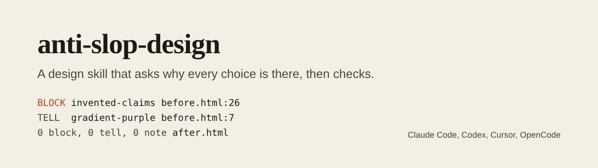
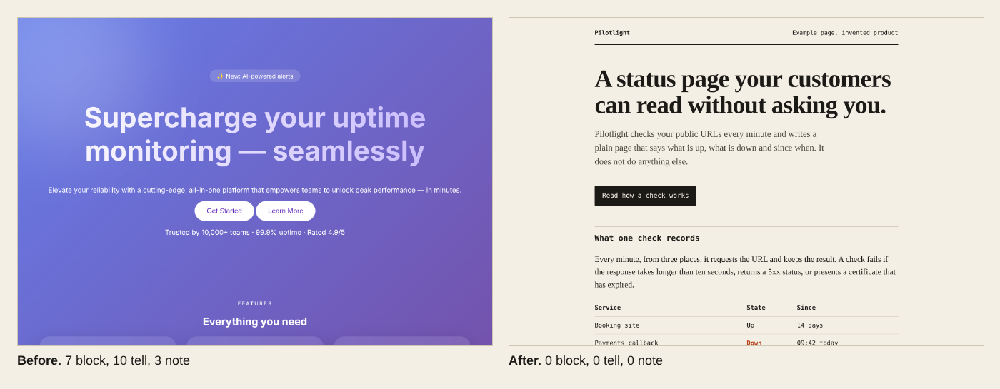

# anti-slop-design



[](https://github.com/pJijesh/anti-slop-design/actions/workflows/test.yml) [](LICENSE)  

**Problem:** coding agents build pages that look generated: the same typeface, the same purple gradient, three identical cards, a row of invented testimonials. Telling the agent to "make it look good" does not fix it, because every choice is still the most probable one.

**For:** engineers, founders and IT leaders who let an AI agent build or redesign web pages and want the result to look as if a person designed it for a specific purpose.

**Demonstrates:** an agent skill with a clear process (brief, direction, build, lint, review, report), a zero-dependency linter that checks the output against 29 named tells, installers for four agents, and a before and after pair that the linter itself scores.



## What it does

- **A process the agent follows.** Brief first, then a written direction, then the first screen, then a lint, then a review by eye, then a report. See [`SKILL.md`](skills/anti-slop-design/SKILL.md).
- **One rule underneath everything.** Every visible choice must trace back to the subject, the audience or the job of the page. If it cannot, it is a default, and defaults are what readers recognise as machine-made.
- **A floor that is never traded for style.** No invented statistics, testimonials or people; contrast, focus and reduced motion; a working phone layout; no placeholder copy.
- **Ten short references**: [brief](skills/anti-slop-design/references/brief.md), [directions](skills/anti-slop-design/references/directions.md) (six starting points and how to invent your own), [typography](skills/anti-slop-design/references/typography.md), [colour](skills/anti-slop-design/references/colour.md), [layout](skills/anti-slop-design/references/layout.md), [copy](skills/anti-slop-design/references/copy.md), [states and motion](skills/anti-slop-design/references/states-and-motion.md), [content integrity](skills/anti-slop-design/references/content-integrity.md), [review](skills/anti-slop-design/references/review.md) and the generated [tells catalogue](skills/anti-slop-design/references/tells.md).
- **A linter** (`tells.mjs`, Node 18 or later, no packages) with 29 rules in three tiers: 8 block, 16 tell and 5 note. Blocks are accessibility and honesty. Tells are common defaults. Notes are questions. Every finding says why it matters and what to do instead.
- **Overrides with a reason.** `anti-slop-ignore <rule-id>: <reason>` keeps a deliberate choice, and the linter lists every override. An override without a reason is itself a block.
- **Installers** for Claude Code, Codex, OpenCode and Cursor.

## Install

Requires Node 18 or later. From a clone of this repository:

```bash
# into the current project, for one agent or all four
node scripts/install.mjs claude
node scripts/install.mjs codex
node scripts/install.mjs opencode
node scripts/install.mjs cursor
node scripts/install.mjs all --dry-run     # show what would be written

# Claude Code, for every project
node scripts/install.mjs claude --global
```

| Agent | What is written |
| --- | --- |
| Claude Code | The whole skill in `.claude/skills/anti-slop-design/` (or `~/.claude/skills/` with `--global`) |
| Codex | The skill in `.agents/skills/anti-slop-design/` and a marked block in `AGENTS.md` |
| OpenCode | The skill in `.opencode/skills/anti-slop-design/` and a marked block in `AGENTS.md` |
| Cursor | A rule in `.cursor/rules/anti-slop-design.mdc` and the linter in `.cursor/anti-slop-design/` |

The `AGENTS.md` block sits between `anti-slop-design:start` and `anti-slop-design:end` markers, so reinstalling replaces it and never touches the rest of the file.

Then ask your agent, for example: "Using the anti-slop-design skill, build a landing page for ...". To check an existing page without changing it:

```bash
node skills/anti-slop-design/scripts/tells.mjs path/to/site          # fails on any block
node skills/anti-slop-design/scripts/tells.mjs path/to/site --fail-on tell
node skills/anti-slop-design/scripts/tells.mjs index.html --json
```

## How it works

```text
brief  ->  direction  ->  build first screen  ->  lint  ->  review by eye  ->  report
 6 lines    written       390 and 1280 px         fix      squint, cover-the-    what was kept
            choices                               blocks   logo, sentence,       on purpose and
                                                           delete, keyboard      what was not checked
```

Running the linter on the two example pages in [`examples/`](examples/):

```text
before.html: 7 block, 10 tell, 3 note, 0 override(s)    exit 1
after.html:  0 block, 0 tell, 0 note, 0 override(s)     exit 0
```

[`before.html`](examples/before.html) is a deliberately generic landing page. [`after.html`](examples/after.html) is the same invented product built from a written direction (printed document: paper, ink, one signal colour, a serif with a monospace, a table, copy that says what it does and what it does not). Both describe a fictional product.

## How it is built

```text
.
├── skills/anti-slop-design/
│   ├── SKILL.md                    The process, the floor, the commands
│   ├── core.md                     The condensed text used for AGENTS.md and Cursor
│   ├── references/                 Ten short documents; tells.md is generated
│   └── scripts/
│       ├── tells.mjs               The linter
│       └── rules.json              Rule metadata: tier, why, fix
├── scripts/
│   ├── install.mjs                 Installer for the four agents
│   ├── build.mjs                   Generates tells.md and the adapters; --check for CI
│   └── shots.mjs                   Renders the example screenshots (needs Playwright)
├── adapters/                       Generated AGENTS.md block and Cursor rule
├── examples/                       before.html and after.html
├── test/                           node:test suites
└── .github/workflows/test.yml
```

## Design choices

- **A direction, not a theme.** Themes give every page the same few looks. A direction is a set of linked choices (type, colour logic, how space is divided, behaviour) that the agent writes down and then builds from, and that comes from the subject.
- **Honesty is the floor.** Invented statistics, testimonials and people are blocked, the same as missing alt text, because a convincing fake is worse than a plain truth.
- **Tiers with different consequences.** Blocks fail the run. Tells ask for a deliberate replacement or a recorded reason. Notes are questions. This keeps the linter useful without turning it into a taste police.
- **Overrides are first class.** If the person wants a gradient, the agent does it and records why. The aim is to stop unconsidered defaults, not to overrule a decision.
- **Zero dependencies, deterministic output.** The linter reads files and prints; it does not need a browser, a network or a package install. The same input gives the same output.
- **One source for every adapter.** The Cursor rule, the `AGENTS.md` block and the tells catalogue are generated from `core.md` and `rules.json`, and a test fails if they drift.

## Limitations

- **It cannot make a design good.** The linter finds patterns with regular expressions. It cannot judge composition, proportion or taste, which is why the process ends with a review by eye.
- **It cannot guarantee a page will not look AI-generated.** It removes common tells and asks for deliberate choices. A determined or unlucky run can still produce something bland.
- **Heuristics miss and misfire.** A page can avoid every rule and still be generic, and a rule can flag something that is intended. Use an override with a reason for the second case.
- **No browser checks.** Contrast ratios, overflow at 390 pixels and keyboard order are in the review steps, not in the linter.
- **Static markup only.** Styles built at run time, in a CSS-in-JS library for example, may not be seen.
- **The installer paths follow each tool's documentation as I understand it.** They have not been tested inside Claude Code, Codex, OpenCode or Cursor themselves.
- **Rules are my judgement.** The tells come from what appears often in generated pages, and the thresholds are a starting point to tune.

## Verification status

- The test suite covers every one of the 29 rules with a positive sample, a clean page, thresholds, the tiers, overrides with and without a reason, the command line and its exit codes, determinism, each installer in a temporary directory (including that reinstalling does not duplicate the `AGENTS.md` block and that the installed linter runs), that the generated files are current, and repository hygiene.
- Both example pages were rendered with Playwright and looked at; the screenshots in `docs/images` come from those renders.
- The linter was run on the two example pages and gives the results shown above.
- It was run on Node 22 here. The CI workflow covers Node 18, 20 and 22 and was not run from this environment.
- It has not been measured against real agent output, so there is no claim of how much it improves a given agent's results.

## Roadmap

Planned, not promised.

- **Next:** Try it on pages produced by each of the four agents and tune the rules from what is found
- **Then:** Add a rendered check for contrast and 390 pixel overflow as an optional script
- **Later:** More directions and worked examples for dashboards and forms

## Related work

Other projects tackle the same problem and are worth a look: [nutlope/hallmark](https://github.com/nutlope/hallmark), [pbakaus/impeccable](https://github.com/pbakaus/impeccable) and [jakubkrehel/skills](https://github.com/jakubkrehel/skills). This repository is independent and shares none of their code.

## Licence

[MIT](LICENSE), 2026 Puliyappottammal Jijesh. See [CONTRIBUTING](CONTRIBUTING.md) for how to suggest a rule or a direction.

Built by [Puliyappottammal Jijesh](https://www.linkedin.com/in/pjijesh), an IT manager. [GitHub](https://github.com/pJijesh)
